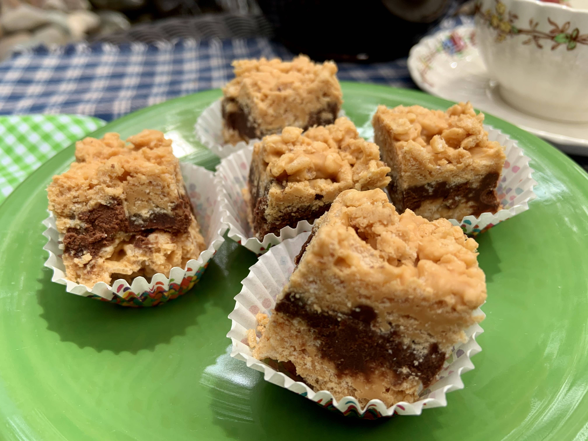

<!-- Replace the img src file path below with the same path you used in the YAML above -->

  

## Crunchy Fudge Cookies

## Ingredients
- 1 bag Butterscotch Chips
- 1 cup Peanut Butter (something with added sugar like Jiffy or Skip)
- - 8 cups Rice Krispies Cereal
- 3 cups Chocolate Chips
- 4 tbs Butter
- 2 tbs Water
- 1 cup Powdered Sugar

## Instructions

1. Add the butterscotch chips and peanut butter to a large pot and melt on medium low. Once butterscotch chips are melted, mix until combined. 
2. Turn off the heat and mix in the Rice Krispies, one cup at a time. Coat Rice Krispies evenly. 
3. In a separate medium sauce pan, combine the chocolate chips, butter, water and powdered sugar and melt on low. Mix until combined. 
4. In a 9x13 pan, spread half of the Rice Krispies mixture out as an even layer. Then, spread all of the choclate mixuture out on top.
5. Place the pan into the fridge for 15-20 minutes so the chocolate firms up. Then, spread the remaining Rice Krispies onto the top. Place back into the fridge for 20 minutes.
6. Remove from fridge and cut into square-shaped cookies. Enjoy eating the crumbs! 
